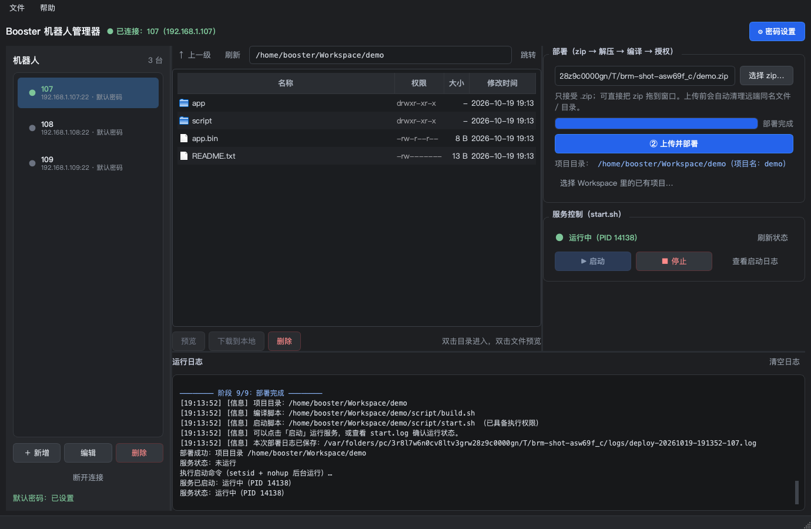

# Booster 机器人管理器（BRM）

一个用于管理多台 **Booster 人形机器人** 的桌面工具：远程浏览文件、上传并部署 zip 工程、编译、启动 / 停止服务。

技术栈：**Python 3.10+ · PySide6 · paramiko**，所有界面文案与错误提示均为简体中文。



---

## 一、功能一览

| 编号 | 功能 | 说明 |
| --- | --- | --- |
| R0 | 密码设置与自动复用 | 默认密码只需设置一次，之后所有连接默认复用；仅认证失败时询问重输 |
| R1 | 多机器人管理 | 左侧列表显示名称 / IP / 在线状态，支持新增、编辑、删除、断开连接 |
| R2 | 远端文件浏览 | 目录列表、进入 / 上级 / 地址栏跳转、文本预览（前 200 KB）、下载、删除 |
| R3 | 上传 zip | 点击「选择上传内容 ▾」主动选择 zip 或文件夹；**选择/拖入文件夹时先自动打包成 zip**，再上传并显示实时进度百分比 |
| R4 | 同名清理 | 上传前自动删除远端同名 zip 与解压目录 |
| R5 | 文件白名单 | 只允许 `.zip`，本地扩展名 + 文件头 + 远端二次校验 |
| R6 | 解压与项目目录 | 自动识别唯一顶层目录，避免 `xxx/xxx/` 双重嵌套 |
| R7 | 编译 | 定位 `scripts/build.sh`，编译阶段同时给 `stop.sh` 授权；实时流式回显输出；**部署面板单独显示编译进度（百分比 / 已完成包数 / 输出行数 / 耗时）**，并显示退出码 |
| R8 | 启停控制 | 启动 / 停止 / 刷新状态；启动时自动输入密码（sudo / systemctl）；停止优先执行项目 `scripts/stop.sh`；按项目进程识别一次性启动脚本；查看 start.log 末尾 200 行；**实时监视 brain.log（tail -f，窗口随日志帧自动调整大小）** |
| R9 | rerun 联调 | 打包前检查 `src/brain/config/config.yaml`：`rerunLog.enable_tcp: true` 时自动把 `server_ip` 改成本机局域网 **IP:9876**（原值已有端口则沿用；只改 zip 内副本）；启动 start.sh 前自动打开 `rerun-0.20.3` / Windows `rerun-cli-*.exe`，并等待其监听 9876 后再运行 start.sh |
| R10 | 足球地图监视 | 打开时自动检测并连接所有可连接的机器人，解析各自 brain.log 的 `FIELD_POSE` 与 `[BALL]`；按 kid_size（9×6 m）真实比例绘制机器人位置/朝向与球位置，机器人及它看到的球使用同一颜色 |
| R11 | 上传前身份替换 | 上传入口旁可开关；开启后选择 **Team ID / 球员编号**，上传前替换 zip 内所有 `config.yaml` 的 `team_id`、`player_id`（只改上传包，不改本地源文件） |

界面中所有耗时操作（连接、上传、编译、启停、文件读写）都在 `QThread` 中执行，不会阻塞界面。

---

## 二、环境要求

- Python **3.10+**（开发与自测环境：Python 3.12.15）
- macOS 或 Windows（开发环境：macOS 27.0.1 / arm64）
- 机器人侧：Ubuntu Linux、SSH 服务、`unzip`、`setsid`（Ubuntu 默认自带 util-linux）
- 运行依赖：`PySide6>=6.5`、`paramiko>=3.0`（见 `requirements.txt`）

---

## 三、安装与运行

```bash
# 1. 进入项目目录
cd BoosterRobotManager

# 2. 创建虚拟环境（可选但推荐）
python3 -m venv .venv

# 3. 安装依赖
#    macOS / Linux
.venv/bin/pip install -r requirements.txt
#    Windows（PowerShell）
#    .venv\Scripts\pip install -r requirements.txt

# 4. 启动
.venv/bin/python -m brm
#    或者：.venv/bin/python run.py
```

Windows 下把 `.venv/bin/python` 换成 `.venv\Scripts\python` 即可；也可以直接双击 `run.py`（需已装好依赖）。

启动后程序会加载 `brm/config/robots.json`；文件不存在时会自动创建，并预置一台 `192.168.1.107`（密码为空，等待用户设置）。

### Windows 便携版（.exe，无需安装 Python）

Windows 免安装便携包通过 **GitHub Releases** 发布（不再提交到 git 仓库，避免仓库过大）。v1.1.1 起包内已内置 Windows 版 `rerun-cli-0.20.0-x86_64-pc-windows-msvc.exe`，点击启动时会自动打开查看器：

- 下载页面：<https://github.com/Worril-224/BoosterRobotManager/releases/latest>
- 资产文件：`BoosterRobotManager-Windows-x64.zip` 和 `BoosterRobotManager-Windows-x64.zip.sha256`

使用方式：

1. 把 zip 解压到**有写入权限**的目录（桌面 / 文档；不要放 `C:\Program Files`）；
2. 双击 `BoosterRobotManager.exe` 启动，无需安装 Python；
3. 首次启动在「⚙ 密码设置」里设置机器人默认密码。

说明与排查：

- 程序未签名，Windows 可能提示"已保护你的电脑"：点「更多信息 → 仍要运行」，或右键 exe → 属性 → 解除锁定；
- 双击无反应 / 想查看报错：运行同目录的 `BoosterRobotManager-Console.bat`；
- 配置和日志分别在 `brm\config\robots.json`、`brm\logs\`；
- 若提示缺少 DLL，请安装「Microsoft Visual C++ 2015-2022 运行库（x64）」；
- 本地重新构建 Windows 包：`.venv/bin/python tools/build_windows_bundle.py`（需 `pip install ziglang`），产物在 `dist-windows/`，发布时上传到 Releases。

重新构建（在 macOS / Linux 上交叉构建）：

```bash
.venv/bin/pip install ziglang
.venv/bin/python tools/build_windows_bundle.py
```

> 该 Windows 包由 macOS 交叉构建：已校验 PE x64 GUI 子系统、图标资源、Python/PySide6/paramiko 依赖完整性与示例配置无密码；**尚未在真实 Windows 机器上运行验证**。

### macOS 一键启动（推荐）

项目根目录已生成两个启动器，双击即可运行：

| 启动器 | 说明 |
| --- | --- |
| **Booster机器人管理器.app** | 双击直接打开程序（不弹终端窗口）；可拖到「应用程序」文件夹或程序坞 |
| **启动 Booster 机器人管理器.command** | 打开终端启动，能看到启动日志，适合排查问题 |

- 首次在别的机器上运行、或 `.venv` 被删除时，`.app` 会提示安装依赖并自动打开终端完成安装（约 1–3 分钟）。
- 启动器的路径是在**生成时写死**的。如果移动了项目目录，重新执行：

```bash
.venv/bin/python tools/build_launcher.py
```

- 想换图标：修改/运行 `tools/make_icon.py` 重新生成 `tools/app_icon.png`，再执行上面的命令。
- 如果从未签名的压缩包解压后 macOS 提示「无法打开」，右键 .app →「打开」一次即可（本地生成的 .app 不会被拦截）。

---

## 四、快速上手

1. 点击右上角 **⚙ 密码设置**，输入机器人密码并保存（Booster 出厂默认密码通常为 `booster`，请以实际为准）。
2. 在左侧点击机器人，程序会 **自动使用已保存密码登录**，成功后状态变绿「已连接」。
3. 在 **文件浏览** 区查看 `/home/booster/`，双击目录进入，双击文本文件预览。
4. 在右侧 **部署** 面板点击 **「选择上传内容 ▾」**，主动选择 **zip 文件** 或 **文件夹**（文件夹会先在本地自动打包成 zip）；也可以把 zip / 文件夹直接拖入窗口。然后点击 **② 上传并部署**：
   校验 → 清理远端同名文件 → 上传 → 解压 → 定位项目目录 → 编译 → 授权 start.sh。
   上传完成后进度区会切换到 **编译进度**（百分比 / 包数 / 输出行数 / 耗时），编译结束后保留最终结果。
> 需要上传前统一修改队伍/球员编号时，勾选 **「上传前修改 Team ID / 球员编号」**（在「选择上传内容」下方），填好 Team ID 与球员编号；上传前会改写 zip 内 `config.yaml`，本地源文件不变。

5. 编译成功后点击 **▶ 启动**；用 **刷新状态**、**查看启动日志**、**■ 停止** 管理服务。
6. 启动后可点击 **「监视 brain.log」**，弹窗会实时执行 `tail -f <项目目录>/brain.log`；日志持续输出时窗口大小保持稳定、不会闪烁；日志停顿约 0.7 秒后才会按最新一帧自动适配一次（可取消勾选后手动调整）。
7. 启动后点击 **「足球地图」**：窗口会自动检测所有配置机器人，把可连接的机器人全部接入；分别解析各自 brain.log 中的 `FIELD_POSE`（x/y/θ）和 `[BALL] fld=(x,y)`，按 kid_size 9×6 m 比例绘制足球场。每台机器人一种颜色（三角形带朝向与轨迹），它看到的球用**同色**实心圆点标注。
8. 如果工程使用 rerun：打包时会自动把 `<工程>/src/brain/config/config.yaml` 中 `rerunLog.enable_tcp: true` 的 `server_ip` 改成本机 IP:9876（原值带端口则沿用原端口）；点击启动时会先自动打开 `rerun-0.20.3` 查看器，**等待其监听 9876 后才运行 start.sh**（最多等 30 秒；未放置 rerun 则跳过等待直接启动）。

> 重新打开程序后无需再次输入密码：密码已持久化，连接时自动复用。

---

## 五、项目结构

```
BoosterRobotManager/
├── brm/
│   ├── __main__.py              # python -m brm 入口
│   ├── app.py                   # QApplication 启动
│   ├── constants.py             # 默认值 / 路径常量
│   ├── core/
│   │   ├── errors.py            # 分级错误体系 + 连接异常归类
│   │   ├── ssh_client.py        # SSH 连接、命令执行、流式输出
│   │   ├── sftp_client.py       # 上传 / 下载 / 列目录 / 读文件
│   │   ├── session_manager.py   # 常驻会话与密码复用
│   │   ├── robots.py            # 机器人配置 + Base64 密码存储
│   │   ├── zipguard.py          # zip 白名单 / 非法路径校验
│   │   ├── scripts.py           # build.sh / start.sh 查找规则
│   │   ├── deployer.py          # 9 阶段部署流水线
│   │   ├── build_progress.py    # 解析编译输出进度（cmake/ninja/colcon）
│   │   ├── local_zip.py         # 选择文件夹时本地自动打包 zip
│   │   ├── brain_log_parser.py  # 解析 brain.log 的 FIELD_POSE / [BALL]
│   │   ├── identity_config.py   # 上传前改写 team_id / player_id
│   │   ├── field_geometry.py    # kid_size 场地尺寸
│   │   ├── rerun_config.py      # 打包前改写 rerunLog server_ip
│   │   ├── rerun_viewer.py      # 启动 start.sh 前打开 rerun 查看器
│   │   ├── proc_control.py      # start.sh 启动 / 停止 / 状态 / 日志
│   │   ├── remote_env.py        # 远端 ROS 环境（setup.bash）自动加载
│   │   ├── logbook.py           # 本地部署日志（密码打码）
│   │   └── util.py              # shell 转义、危险路径拦截、格式化
│   ├── ui/
│   │   ├── main_window.py       # 主窗口
│   │   ├── brain_log_monitor.py # brain.log 实时监视窗口（tail -f）
│   │   ├── field_monitor.py     # brain.log → 足球地图监视窗口
│   │   ├── file_browser.py      # 文件浏览面板 / 文本预览
│   │   ├── deploy_panel.py      # 部署 + 服务控制面板
│   │   ├── password_dialog.py   # 密码设置 / 重输
│   │   ├── settings_dialog.py   # ⚙ 设置（默认密码 / 超时 / 测试连接）
│   │   ├── robot_dialog.py      # 新增 / 编辑机器人
│   │   ├── project_picker.py    # 选择 Workspace 里已有项目
│   │   ├── service_log_dialog.py# start.log 查看
│   │   ├── workers.py           # QThread 工作线程
│   │   └── theme.py             # 深色 QSS
│   ├── config/robots.json       # 机器人配置（示例，无真实密码）
│   ├── logs/                    # 本地部署日志（首次部署时创建）
│   └── temp/                    # 文件夹自动打包的临时 zip（退出时清理）
├── tests/                       # 121 个自动化测试（含本地 FakeRemote 集成测试）
├── tools/
│   ├── selfcheck.py             # 交付自检脚本
│   ├── screenshot.py            # 生成界面截图
│   ├── make_icon.py             # 生成应用图标（Pillow）
│   ├── build_windows_bundle.py  # 交叉构建 Windows 便携版 .exe
│   ├── app_icon.ico             # Windows 启动器图标
│   └── build_launcher.py        # 生成 .app / .command 启动器
├── screenshots/                 # README / 报告用截图
├── dist-windows/                # 本地交叉构建输出（不提交，发布到 GitHub Releases）
├── rerun-0.20.3/                # 本地 rerun 查看器（体积大，不提交）
├── Booster机器人管理器.app       # macOS 双击启动（由 build_launcher.py 生成）
├── 启动 Booster 机器人管理器.command  # macOS 终端启动器
├── run.py                       # 源码运行 / PyInstaller 打包入口
├── requirements.txt
├── requirements-dev.txt
├── README.md
└── 验收自测报告.md
```

---

## 六、密码设置说明（R0）

- **默认密码**：在「⚙ 密码设置」中设置，所有机器人共用，只需设置一次。
- **单台覆盖**：编辑机器人时密码框单独填写，仅该台生效；**留空 = 使用默认密码**。
- 编辑对话框中提供「**清空密码、改用默认密码**」按钮；设置对话框中可一键清除全部单台覆盖。
- **首次连接**：配置里没有任何密码时，机器人列表上方显示醒目提示「尚未设置机器人密码，请先设置」，并在首次发起连接前弹出密码设置对话框。
- **自动复用**：连接时直接使用已保存密码，不会每次弹框。
- **认证失败才提示**：只有 paramiko 抛出 `AuthenticationException`（或认证失败类错误）时才弹「密码不正确，是否重新输入？」。确认后立即用新密码 **重试一次**，成功后保存为该机器人的密码；再次失败则提示「密码不正确，或账号 / 权限不足」，原密码保持不变，**不会循环弹窗**。
- **其他错误单独提示**：连接超时、拒绝连接 / 网络不可达、主机密钥异常等各有独立提示，绝不会误报为密码错误。
- **测试连接**：设置窗口中可选择机器人，用当前输入的密码验证；成功显示「密码校验通过」，认证失败按 R0 规则提示重新输入。
- 私钥登录：机器人编辑对话框可切换「私钥文件登录」，此时不读取密码。

---

## 七、密码存储安全边界（务必阅读）

- 密码保存在 `brm/config/robots.json` 的 `settings.default_password` / `robots[].password` 字段，使用 **Base64 混淆**（`b64:` 前缀）存储。
- **Base64 不是加密**：任何能读取该文件的人都可以还原密码。该方案仅用于避免“肉眼看明文 / 直接搜索到明文”，**仅适用于可信的本地环境**（个人电脑、有磁盘加密、有系统登录口令）。
- 程序会尽量把配置文件权限收紧为 `600`（仅当前用户可读写；Windows 上受文件系统限制）。
- 日志与界面输出中的密码统一打码为 `******`；部署日志在写入前会做密码替换。
- 当前版本 **未使用 keyring**，因此没有钥匙串依赖。若你希望更高安全性，可自行把 `RobotStore` 的密码读写替换为 keyring（macOS 钥匙串 / Windows 凭据管理器），并保留 keyring 不可用时的 Base64 降级逻辑。
- 密码只通过 SSH 加密通道发送到机器人，不会上传到任何第三方服务。

---

## 八、默认约定与关键假设

以下默认值都可在界面或配置中修改，业务逻辑中没有硬编码：

| 项目 | 默认值 |
| --- | --- |
| SSH 账号 / 端口 | `booster` / `22` |
| 上传目录 | `/home/booster/Workspace/` |
| 文件浏览根目录 | `/home/booster/` |
| 连接超时 | 10 秒（设置中可改） |
| 命令执行超时 | 600 秒（设置中可改） |
| 默认机器人 | `192.168.1.107`（名称 `107`） |
| 文本预览上限 | 200 KB |
| start.log 查看行数 | 末尾 200 行 |
| 启动时自动输入的密码次数 | 2 次（`constants.START_PASSWORD_INPUT_COUNT`） |

关键实现假设：

1. **解压策略**：zip 内部只有一个顶层目录时，执行 `unzip -o <zip> -d /home/booster/Workspace/`，项目目录取该顶层目录（例如 `demo.zip` 内含 `demo/` → 项目目录 `/home/booster/Workspace/demo`），避免 `demo/demo` 双重嵌套；否则解压到 `/home/booster/Workspace/<zip名>/`，项目目录就是它。解压时排除 `__MACOSX/*` 与 `.DS_Store`。
2. **R4 清理范围**：上传前删除 `Workspace/<zip名>` 与（单顶层目录模式下的）`Workspace/<顶层目录>`，删除失败立即中止，不会继续上传。
3. **脚本定位**：优先 `<项目目录>/scripts/build.sh`、`<项目目录>/scripts/start.sh`（Booster 工程常用目录）；兼容旧的 `<项目目录>/script/`；都找不到时在项目目录内递归查找唯一的同名脚本。找不到或找到多个都会报错。**编译成功但找不到 start.sh 时会报错并中止部署**（因为无法完成授权和启动）。如果工程里有 `stop.sh`，会在编译阶段自动 `chmod +x`（找不到则跳过，不中断部署）。
4. **启动 / 停止**：启动用 `setsid` + `nohup` 后台运行，PID / 日志分别写入 `Workspace/<项目名>.start.pid` / `.start.log`。停止时如果项目里有 `scripts/stop.sh`，优先执行它（多节点 ROS 工程只有 stop.sh 知道该停哪些进程）；没有 stop.sh 才回退到 `kill -TERM -<pid>` → `kill -KILL -<pid>` → `pkill -f <项目目录>/scripts/start.sh`。
5. **危险路径保护**：部署相关删除只允许发生在配置的上传目录内；文件浏览删除只允许在文件浏览根目录内，且不能删除根目录本身。
6. **删除正在运行的服务工程**：部署前若检测到服务正在运行，会提示「是否先停止服务再部署」；如果选择继续，部署会清理工程目录，请自行确认风险。
7. **文件夹自动打包**：部署面板选择/拖入文件夹时，程序用 Python 标准库 `zipfile` 在本地打包成 zip 再上传，规则：
   - zip 内保留顶层文件夹（解压后为 `<文件夹名>/...`）；
   - 自动跳过 `.git`、`.venv`、`build`、`install`、`log`、`__pycache__`、`node_modules` 等目录以及 `.DS_Store` / `*.pyc`；
   - 保留文件可执行位，并给所有 `.sh` 自动补执行位（Windows 源文件没有 Unix 执行位）；跳过符号链接；
   - 临时 zip 存放在 `brm/temp/`，程序退出时自动清理。
8. **远端 ROS 环境自动加载**：通过 SSH 非交互执行命令时不会加载 `~/.bashrc`，`ros2` / `colcon` 可能不在 PATH。BRM 会在编译、启动、停止前自动 source：
   - `/opt/ros/*/setup.bash`（ROS 发行版）
   - `/opt/booster/BoosterRos2/install/setup.bash`（Booster 机器人 ROS 工作空间）

   文件不存在会自动跳过，日志中会输出 `[BRM] 已加载远端环境：...`。

9. **rerun 配置与查看器**（R9）：
   - 文件夹打包前查找 `<工程>/src/brain/config/config.yaml`；
   - 若 `rerunLog.enable_tcp: true`，只把 **zip 内**该文件的 `server_ip` 改为本机局域网 **IP:端口**（原 server_ip 没有端口时补 `9876`，已有端口则沿用；本机源文件不动）；本机 IP 优先按到机器人的路由选择，保证机器人可访问；
   - 若 `enable_tcp: false`、没有该配置或拿不到本机 IP，则保持原样并记录日志；
   - 点击「▶ 启动」时，在工程目录 / BRM 目录 / 当前目录查找 `rerun-0.20.3/rerun`（macOS 也支持 `Rerun*.app`），也支持直接放在根目录的 Windows `rerun-cli-*.exe`；
   - 启动后**等待 rerun 真正监听 9876 端口**（最多 30 秒）才继续运行 start.sh；若 9876 已监听则直接继续；
   - 找到 rerun 但启动失败/退出/超时 → 中止本次 start.sh 并提示；本机完全没有 rerun → 记录日志后按原流程启动（兼容不使用 rerun 的工程）。

---

## 九、部署流水线（日志中的 9 个阶段）

```
阶段 1/9  校验本地压缩包（扩展名 / 文件头 / 非法路径）
阶段 2/9  检查并清理远端同名文件 / 目录（R4）
阶段 3/9  上传 zip（实时进度）
阶段 4/9  远端文件类型校验（扩展名 + 文件头）
阶段 5/9  解压（检测 unzip）
阶段 6/9  定位项目目录（避免双重嵌套）
阶段 6.5  加载远端 ROS 环境（/opt/ros/*/setup.bash、BoosterRos2），再编译
阶段 7/9  编译（chmod +x build.sh；同时给 stop.sh 授权，实时流式输出，失败即中止）
阶段 8/9  查找并授权 start.sh（chmod +x）
阶段 9/9  完成
```

每次部署都会在 `brm/logs/` 下生成 `deploy-<时间戳>-<机器人>.log`，内容与界面日志一致（密码已打码）。

> 如果 `start.sh` 报 `ros2: No such file or directory`，通常是远端 shell 没有加载 ROS 环境；BRM 已自动处理（见第八节第 7 条），日志中应能看到 `[BRM] 已加载远端环境：/opt/ros/...`。

### 启动 / 停止时自动输入密码（sudo / systemctl）

部分项目的 `start.sh` / `stop.sh` 在运行过程中需要输入密码（脚本里多次调用 `sudo`，
或直接调用 `systemctl` 触发 polkit 授权）。BRM 在点击「启动」/「停止」时自动完成：

1. 取当前机器人使用的密码（默认密码；若设置了单台覆盖则用覆盖密码）；
2. 通过 SSH 通道的**标准输入**写入两遍（不会出现在命令行参数中，远端 `ps` 看不到，也不会写入日志）；
3. **不写任何机器人文件**：在远端 shell 中定义同名 **shell 函数** 并 export 给 start.sh / stop.sh：
   - `sudo()`：用 `printf 密码 | sudo -S` 从标准输入读密码；
   - `systemctl()`：带 `--user` 原样执行，系统级调用自动转成 `sudo -S systemctl ...`，
     解决裸 `systemctl stop xxx` 的 polkit 密码提示。
   脚本结束后立即 `unset`，机器人上不会产生 `.brm-helpers` 之类的辅助文件。
4. 停止时如果项目里有 `scripts/stop.sh`，会执行它（同样自动输入密码），这也是多节点
   ROS 工程唯一可靠的停止方式。
5. 启动前程序会自动给工程内的 `start.sh` / `build.sh` / `stop.sh` 补执行权限，
   **不需要人工登录机器人执行 chmod**。

> 限制：如果脚本直接写死绝对路径 `/usr/bin/sudo`、或从 `/dev/tty` 读取密码，则无法自动输入；
> 请改成使用 PATH 中的 `sudo` / `systemctl`。

---

## 十、常见问题（FAQ）

**Q1：提示「密码不正确」和「连接超时」有什么区别？**
只有机器人明确拒绝认证时才会提示密码不正确；超时 / 拒绝连接 / 无法解析 IP 会分别提示「连接超时」「连接被拒绝」「网络不可达」。IP 填错（例如 `192.168.1.999`）会提示网络不可达，不会误报密码错误。

**Q2：提示「主机密钥异常」怎么办？**
机器人重装过系统会导致 known_hosts 中的旧密钥不匹配。确认机器人身份后执行 `ssh-keygen -R 192.168.1.107` 清除旧记录，再重新连接。

**Q3：部署提示「远端未安装 unzip」。**
在机器人上执行：`sudo apt install -y unzip`。

**Q4：编译输出在哪里看？**
界面「运行日志」区实时滚动显示合并后的 stdout + stderr，并显示退出码；非 0 会标记「编译失败」且不继续后续步骤。

**Q5：启动失败怎么办？**
先看「查看启动日志」中的 `start.log`；常见原因：依赖未安装、端口被占用、start.sh 内路径写错。也可以直接在机器人上执行 `bash <项目目录>/scripts/start.sh` 复现。

**Q6：忘记密码 / 密码填错了？**
在「⚙ 密码设置」中重新输入并保存即可立即生效，无需重启程序。单台覆盖密码可在机器人编辑对话框中清空，回到默认密码。

**Q7：配置损坏了怎么办？**
程序会提示「配置文件读取失败」并给出路径；修复 JSON 或删除该文件后重启（会重新生成默认配置，密码需要重新设置）。

**Q8：为什么密码不是加密保存？**
见第七节「密码存储安全边界」：Base64 仅做混淆，安全边界依赖可信本地环境与磁盘加密。

**Q9：双击 .app 没反应或提示找不到项目？**
项目目录被移动过会导致启动器里记录的旧路径失效，执行 `.venv/bin/python tools/build_launcher.py` 重新生成即可。如果是首次运行缺依赖，`.app` 会弹提示并自动打开终端安装。

**Q10：如何把启动器放到程序坞？**
把 `Booster机器人管理器.app` 拖到「应用程序」文件夹或程序坞即可；`.app` 内部记录的是项目绝对路径，放哪里都能启动，只有移动**项目目录**后才需要重新生成。

**Q11：启动时报 “sudo: a terminal is required to read the password”？**
这是脚本里的 `sudo` 需要交互输入密码。BRM 已支持自动输入密码（见第九节），前提是脚本调用 `sudo` / `systemctl` 命令（BRM 会注入同名 shell 函数，不写文件）。如果项目里直接写死 `/usr/bin/sudo` 绝对路径，需要改成 `sudo ...`。

**Q12：start.sh 能跑完但节点没起来，日志里是 `ros2: No such file or directory`？**
说明编译/启动环境没有加载 ROS。BRM 新版本会在编译和启动前自动 source `/opt/ros/*/setup.bash` 与 BoosterRos2 的 `setup.bash`（不存在的自动跳过），启动日志里会看到 `[BRM] 已加载远端环境：...`。如果机器人 ROS 装在其它位置，可在 `brm/core/remote_env.py` 的 `DEFAULT_SETUP_GLOBS` 中追加路径。

**Q13：start.sh 跑完就退出了，BRM 一直显示「未运行」或停止失败？**
这类工程通常是「一次性启动脚本」：start.sh 拉起 vision / brain / game_controller 等后台节点后自己退出，PID 文件自然失效。BRM 现在会按「工作目录在项目下的进程」判断状态（显示「运行中（检测到 N 个项目进程）」），停止时优先执行项目的 `scripts/stop.sh`。若项目没有 `stop.sh`，BRM 无法判断要停哪些节点，建议补一个。

10. **足球地图（R10）**：解析 brain.log 中以下两种行（自动去除 ANSI 颜色与 `[brain_node-1]` 前缀）：
    - `FIELD_POSE:` 后的 `x: ... m  y: ... m  theta: ... rad ... Calibrated: YES/NO`；
    - `[BALL] fld=(x,y) ... c=... det=Y/N knw=Y/N`。
    场地按 kid_size 绘制：长 9 m、宽 6 m、球门宽 2.6 m、中圈半径 0.75 m、禁区 2×5 m、球门区 1×3 m；坐标原点在场地中心，x 沿场地长度方向，y 沿宽度方向。打开窗口时自动探测所有配置机器人并接入可连接者；每台机器人使用独立颜色，其看到的球用同色实心点显示。`FieldMonitorDialog.add_source()` 仍可用于手动追加数据源。

11. **上传前身份替换（R11）**：部署面板「选择上传内容」下方有开关和两个数字框（Team ID / 球员编号）。开启后，在真正上传前会扫描 zip 内所有 `config.yaml` / `config.yml`：
    - 替换 `team_id:`、`player_id:` 的值（保留缩进、引号和行尾注释）；
    - 若 `game:` 段里缺少这两个键，会自动插入；
    - 只生成一个新的临时 zip 上传，**本地源文件不动**；部署结束后临时 zip 自动清理；
    - 找不到这两个键时会中止上传并提示，关闭开关即可恢复原行为。

**Q14：怎么选择上传文件夹而不是 zip？**
点击部署面板的「选择上传内容 ▾」，在菜单里选「选择文件夹（自动打包为 zip）…」即可；也可以直接把文件夹拖进窗口。选「选择 zip 文件…」则和以前一样直接选择 .zip。

**Q15：监视 brain.log 时提示 tail 退出码 1？**
说明项目的 `brain.log` 还不存在（通常是还没运行 start.sh，或工程目录选错）。先启动服务，确认项目目录下生成了 `brain.log`，再打开监视窗口。

**Q16：打包后 rerun 的 server_ip 没变化？**
检查工程里是否有 `src/brain/config/config.yaml`，以及其中 `rerunLog.enable_tcp` 是否为 `true`；还要确认本机能获取到局域网 IP（BRM 日志会显示「本机局域网 IP」和修改说明）。`enable_tcp: false` 时按设计不会修改。改写后的值形如 `192.168.1.114:9876`；原 server_ip 已带自定义端口时会沿用该端口。

**Q17：启动时没有自动打开 rerun-0.20.3？**
BRM 会在工程目录、BRM 目录、当前目录下查找 `rerun-0.20.3/rerun`（Windows 为 `rerun.exe`，macOS 兼容 `Rerun*.app`），也支持直接放在根目录的 Windows `rerun-cli-*.exe`（v1.1.1 起 Windows 包已内置）。找到后会启动并等待 9876 端口就绪（最多 30 秒），就绪后才运行 start.sh；超时或进程退出会中止启动并提示。若本机完全没有 rerun，则跳过等待直接启动。

**Q18：选择文件夹后为什么还要等一会儿？**
选择或拖入文件夹时，程序会先在本地用 Python 标准库把它压缩成 zip（进度条显示「正在压缩 xx%」），压缩完成后才上传。zip 内会保留顶层文件夹，并自动跳过 `.git`、`.venv`、`build`、`install`、`log`、`__pycache__`、`node_modules` 等目录；临时 zip 保存在 `brm/temp/`，程序退出时自动清理。

**Q19：足球地图里没有机器人/球？**
确认 `brain.log` 里存在 `FIELD_POSE` 与 `[BALL]` 行；刚启动、尚未定位时 `Calibrated: NO` 也会显示。若日志目录不对或 brain 节点未运行，窗口底部会一直显示「等待 FIELD_POSE」。

**Q20：多台机器人怎么同时看？**
点击「足球地图」时会遍历所有已配置机器人，后台检测 SSH 连接；能连上的机器人会自动接入各自 brain.log，窗口顶部显示「已连接 N 台 / 正在检测 / 不可连接」状态。每台机器人使用不同颜色，它的球也用同色圆点。若某台机器人的项目目录与当前项目不同，可在 `FieldMonitorDialog.add_source(name, session, remote_path)` 中手动指定路径。

**Q21：上传前改了 Team ID / 球员编号没有生效？**
确认勾选的是「上传前修改 Team ID / 球员编号」，且压缩包内存在 `src/brain/config/config.yaml` 并包含 `team_id` / `player_id`。如果项目使用其它配置文件，BRM 会提示找不到并中止上传；可关闭开关后先原样上传，再手动修改配置。

---

## 十一、测试与自检

```bash
# 安装开发依赖
.venv/bin/pip install -r requirements-dev.txt

# 全量测试（121 个用例，无需真实机器人）
QT_QPA_PLATFORM=offscreen .venv/bin/python -m pytest tests -q

# 交付自检（真实 socket 错误分级 / 硬编码密码扫描 / 日志打码）
.venv/bin/python tools/selfcheck.py

# 重新生成界面截图
QT_QPA_PLATFORM=offscreen .venv/bin/python tools/screenshot.py
```

测试覆盖：

- `tests/test_zipguard.py`：zip 白名单、非法路径、项目目录推断
- `tests/test_robots.py`：配置读写、密码持久化 / 单台覆盖 / 重启复用
- `tests/test_errors.py`：连接异常分级（认证失败 vs 超时 / 拒绝 / 主机密钥）
- `tests/test_util.py`：shell 转义、危险路径拦截、密码打码
- `tests/test_session_manager.py`：密码自动复用、认证失败重试语义
- `tests/test_ssh_client.py`：命令执行、流式输出、超时
- `tests/test_logbook.py`：日志内容与界面一致、密码打码
- `tests/test_remote_env.py`：远端 ROS 环境命令生成
- `tests/test_deploy_integration.py`：**本地 FakeRemote 集成测试**，真实执行 unzip / chmod / bash / kill，覆盖清理旧部署、非法 zip 拦截、编译失败、流式输出、启停状态
- `tests/test_gui_smoke.py`：offscreen 界面冒烟测试（首次提示、密码状态、连接后浏览、GUI 部署 + 启停、设置对话框测试连接、机器人编辑密码规则）

---

## 十二、可选：PyInstaller 打包

先安装 PyInstaller，再执行：

```bash
.venv/bin/pip install pyinstaller

# macOS：生成 .app
.venv/bin/pyinstaller --noconfirm --windowed --name BoosterRobotManager \
  --add-data "brm/config:config" run.py

# Windows：生成 .exe（注意 --add-data 用分号分隔）
# .venv\Scripts\pyinstaller --noconfirm --windowed --name BoosterRobotManager ^
#   --add-data "brm\config;config" run.py
```

产物在 `dist/`。打包后程序会把配置与日志放在可执行文件所在目录（`config/`、`logs/`）；首次启动会自动创建默认配置。若需要改图标、版本信息，可自行补充 `.spec` 文件。

---

## 十三、已知限制

- 未在真实机器人上做端到端联网验证（开发环境无法访问 `192.168.1.107`），网络与部署逻辑通过真实 socket 错误分级测试 + 本地 FakeRemote 集成测试覆盖；详见 `验收自测报告.md`。
- 未在 Windows 实机验证（代码全部使用 `pathlib`，未使用 `os.system` 执行本地命令；理论兼容）。
- 暂不支持多台机器人并行部署。
- 服务状态判断基于 PID 文件与 `kill -0`，若 PID 恰好被系统复用，可能误判为运行中（概率极低）。
- 启动时的自动密码输入通过 shell 函数注入实现（不写机器人文件），密码在 start/stop 执行期间存在于远端进程环境中；从 `/dev/tty` 或图形授权代理读取密码、或写死 `/usr/bin/sudo` 绝对路径的脚本仍需改脚本或配置免密。
